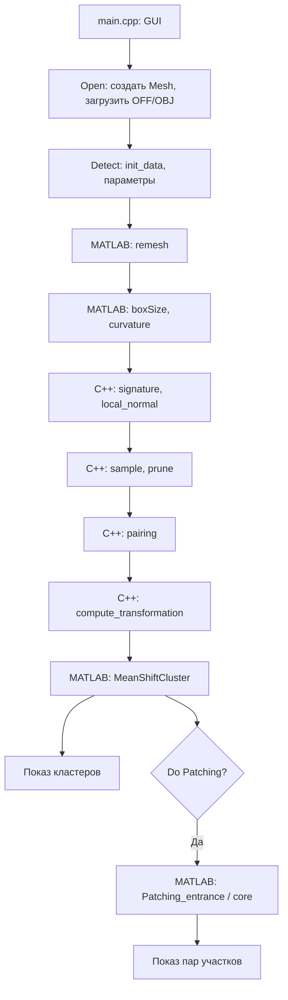

# SymmetryDetection: устройство кода и план переноса на CUDA

**Обновление после этапа 1:** добавлено самостоятельное CPU-ядро, CLI `build/symmetry_cpu_cli`, демонстрационные модели и офлайн-viewer. Актуальные команды и отличия от старой реализации описаны в [CPU_STAGE1_RU.md](CPU_STAGE1_RU.md). Разделы ниже исследуют историческую C++/MATLAB-ветку; её проблемы не следует переносить на новое ядро. Старый CMake сохранён в `cmake/LegacyCMakeLists.txt`, действующий CMake собирает новое ядро без libigl/MATLAB.

Обзор от 8 октября 2026 года. Исследован текущий checkout (`c2dffb7`, `patch cut`). Изменения алгоритма и CUDA-код в рамках этого обзора не вносились.

## 1. Что здесь реализовано

Это исследовательский прототип поиска частичных симметрий треугольной поверхности: похожие по локальной геометрии точки образуют пары, каждая пара голосует за преобразование, кластеры голосов дают кандидатов, а проверка на поверхности выделяет участки.

Такая схема соответствует работе **Niloy J. Mitra, Leonidas Guibas, Mark Pauly, “Partial and Approximate Symmetry Detection for 3D Geometry”, SIGGRAPH 2006**: [страница авторов](https://graphics.stanford.edu/~niloy/research/approx_symmetry/approx_symm_sig_06.html), [статья](https://geometry.stanford.edu/paper/mgp_siggraph_06/mgp_siggraph_06.pdf). Это соответствие общей схемы, а не доказательство точного воспроизведения статьи или авторства данной реализации. В просмотренных основных исходниках явной ссылки на Митру не обнаружено; формулы и эвристики нужно сверять отдельно.

**Проект не является самостоятельной реализацией полностью на C++.** C++/Eigen выполняет загрузку, выборку, фильтрацию, построение пар и вычисление голосов. MATLAB Engine выполняет ремешинг, вычисление кривизн, mean shift и выделение участков. libigl/NanoGUI отвечает за окно и визуализацию.

По умолчанию запускается GUI; автоматического CLI-прохода и экспорта результата нет. Выделение участков выключено (`do_patching = false`), поэтому обычный Detect заканчивается кластерами преобразований. Кластер — гипотеза симметрии; сам по себе он ещё не подтверждённый симметричный участок.

## 2. Карта файлов

| Файл / группа | Назначение и статус |
|---|---|
| `main.cpp` | Действующая точка входа: создать `SymmetryDetector`, настроить и запустить viewer. Закомментированный пример показывает параметры, но не является рабочим CLI. |
| `SymmetryDetector.h/.cpp` | Контроллер: параметры, Open/Detect, последовательность вычислений, показ точек, пар, кластеров и patches. |
| `Mesh.h/.cpp` | Основное вычислительное состояние, C++-этапы и обмен с MATLAB. Именно эту версию следует сначала читать как основу. |
| `reference.h` | Общие include, пространства имён, константа `INF`, enum режимов преобразования. |
| `MeanShiftCluster.m`, `EpanechnikovKernel.m` | Действующая кластеризация и веса ядра. |
| `Patching_entrance.m`, `Patching_core.m` | Проверка гипотез и рекурсивное расширение участков. |
| `remesh.m`, `remeshing_core.m` | Дробление крупных треугольников с добавлением середин рёбер. |
| `BoundingBoxSize.m` | Диагональ ограничивающего параллелепипеда. |
| `graph/` | Геометрические MATLAB-функции: кривизны, нормали, смежность, окрестности, расстояние до треугольника, чтение/запись. Это не построитель итогового графа симметрий. |
| `Mesh_no_patch_cut.cpp` | Альтернативная версия класса `Mesh`, повторяет определения основной версии. Нельзя линковать обе одновременно. |
| `main.old`, `symmetryDetection.h` | Старая монолитная ветка: `main.old` включает `symmetryDetection.h`, а действующий `main.cpp` — нет. В старой ветке отличается даже смысл значения режима 5. |
| `M_Viewer.h/.cpp` | Незавершённый отдельный viewer, не используется действующим `main.cpp`, но попадает в glob сборки. |
| `Copy_of_*.m`, `MeanShiftCluster0.m` | Альтернативные/старые эксперименты. Основной C++ вызывает функции без этих суффиксов. |
| `compute_transformation.m` | Незавершённый черновик с C++-строкой `MatrixXd ...` и неопределёнными именами; основной путь преобразований находится в `Mesh.cpp`. |
| `EularAng2RotMat.m`, `Rot_By_Eular.m`, `showResults.m` | Дополнительные функции преобразований/визуализации; не определяют текущий C++-конвейер. |
| `test*.m`, `cow_cluster_*.mat`, `test_cow_*.mat` | Ручные MATLAB-эксперименты и сохранённые данные. Это не автоматическая система проверки корректности. |
| `CMakeLists.txt`, `cmake/FindLIBIGL.cmake` | Старая сборка C++11 с libigl, viewer, NanoGUI и MATLAB. |
| `CMakeFiles/`, `SymmetryDetection0412.rar` | Старые артефакты сборки и архив. Архив не распаковывался: наличие в нём дополнительных зависимостей/моделей не проверено. |

## 3. Как проходит вычисление



Основная последовательность находится в `SymmetryDetector::detect()`. `on_open_event()` создаёт `Mesh` и вызывает `init_mesh()`. До Open указатель `mesh` равен NULL: Detect не защищён от нажатия до загрузки.

### 3.1. Загрузка и подготовка

`Mesh::readMesh()` читает OFF/OBJ, запоминает исходные количества вершин/граней и вычисляет минимум/максимум двойных площадей. Ошибки чтения явно не обрабатываются.

`init_data()` очищает промежуточные массивы, вычисляет площади текущей сетки, запускает MATLAB Engine и выполняет `clear all`. Добавления корня проекта и `graph/` в MATLAB path здесь нет: доступность функций зависит от окружения MATLAB.

`remesh()`:

- задаёт цель выборки `sample_aim = ceil(vertex_num_0 * sample_ratio)`;
- задаёт `unit_area = totalArea / sample_aim`;
- вычисляет физическую среднюю площадь как `totalArea / 2 / face_num_0`, потому что `igl::doublearea` возвращает удвоенные площади;
- при ненулевом `remesh_fineness` вызывает MATLAB с `cut_area = mean_area / remesh_fineness`;
- MATLAB делит отмеченные рёбра, меняет соседние грани и повторяет проходы, пока не перестают появляться новые грани;
- C++ упорядочивает индексы внутри грани циклическим сдвигом и сортирует грани по первому индексу, затем пересчитывает площади.

Повторный Detect работает уже с изменённой сеткой, но часть величин берёт из исходных `*_0`; это нужно учесть при проверке воспроизводимости.

### 3.2. Локальная геометрия

`compute_local_frame()` вызывает четыре функции:

1. `compute_boxSize()` — MATLAB считает диагональ AABB: `norm(max(V)-min(V))`.
2. `compute_curvature()` — вызывает `graph/compute_curvature.m`.
3. `compute_signature()` — собирает `[k_min/k_max, k_min, k_max]` для каждой вершины.
4. `compute_local_normal()` — берёт векторное произведение двух главных направлений; нормаль `Normal`, возвращённая MATLAB, не используется.

Кривизны вычисляются через тензоры на рёбрах: нормали смежных граней дают подписанный двугранный угол, из направления ребра и угла строится тензор 3×3. Он усредняется на вершинах, сглаживается по смежности, затем для каждой вершины решается задача собственных значений.

**`smooth_radius` здесь фактически число итераций сглаживания, а не радиус в метрах и не множитель `boxSize`.** C++ передаёт его в `options.curvature_smoothing`, MATLAB использует как `niter_averaging`. При значении 1000 сглаживание повторяется 1000 раз для каждой компоненты тензора.

При `k_max == 0` сигнатура использует числовой sentinel ±2147483647, а не IEEE infinity.

### 3.3. Выборка и удаление неустойчивых точек

`sample()` группирует отсортированные грани по площади и выбирает их вершины. Это выборка существующих вершин после ремешинга, не генерация случайных точек внутри треугольников. `sample_from_facegroup()` удаляет повторения и использует `random_shuffle`; маска предотвращает повторный выбор вершины.

`prune_umbilic_points()` удаляет точки с близкими главными кривизнами, в которых главные направления плохо определены. Код сохраняет:

- точки с обеими положительными кривизнами и отношением меньше `prune_threshold`;
- точки с разными знаками кривизн;
- точки с обеими отрицательными кривизнами и отношением больше `1/prune_threshold`.

Результат — `pruned_sample_index` и словарь «индекс вершины → позиция в выборке или -1». Это конкретные условия кода, а не универсальная формула фильтра умбилических точек.

### 3.4. Построение пар

`pairing()` сортирует **все вершины** по трём компонентам сигнатуры и проверяет принадлежность кандидатов отфильтрованной выборке через словарь.

В режимах с масштабом (0 и 5) пары ищутся по отношению кривизн, дополнительно проверяется знак отношения `k_min`. В остальных режимах сначала ищется диапазон по `k_min`, затем проверяется `k_max`.

Общие ограничения:

- расстояние между точками не меньше `0.03 * boxSize`;
- индекс кандидата больше индекса исходной вершины, чтобы исключить дубликаты;
- ориентация пары канонизируется лексикографическим сравнением координат.

Важная эвристика: `find_similar()` обрабатывает только исходные точки с позициями `0, 2, 4, ...` до `sample_num/2` проходов; для остальных диапазон остаётся -1. Это подвыборка источников, а не полный перебор всех пар.

Границы диапазона ищутся линейным проходом с двух концов отсортированного массива. Заранее выделяется буфер под `S*(S-1)/2` пар, где S — число отфильтрованных точек. При 100 000 точек это около 40 GB только под два 32-битных индекса каждой пары, ещё до копирования результата; выражение размера в `int` может переполниться.

### 3.5. Голос в пространстве преобразований

`compute_transformation()` обрабатывает каждую пару независимо:

1. В режимах с масштабом оценивает `s = (k_min(p1)/k_min(p2) + k_max(p1)/k_max(p2))/2`; иначе `s = 1`.
2. Совмещает нормали первым поворотом, затем главные направления вторым.
3. Из матрицы `Rot2 * Rot1` извлекает три угла функцией `RotateMatrix2EularAngle()`.
4. Вычисляет признак отражения и параметры плоскости.
5. Записывает одну строку `transformation`.

| enum / значение | Размер | Строка голоса |
|---|---:|---|
| `TRANSFORM_7D` / 0 | 7 | `s, angles[3], t[3]` |
| `TRANSFORM_6D` / 1 | 6 | `angles[3], t[3]` |
| `ROTATION_3D` / 2 | 3 | `angles[3]` |
| `SYMMETRY_PLANE_4D` / 3 | 4 | `A,B,C,D` при отражении; иначе нули |
| `ROTATION_AND_SYMMETRY_7D` / 4 | 7 | отражение: `π,π,π,A,B,C,D`; иначе `angles[3], normalized(t)[3], norm(t)` |
| `ROT_AND_SYM_AND_SCAL` / 5 | 8 | то же, с `s` в начале |
| `ROTATION_AND_SVECTOR_6D` / 6 | 6 | `angles[3], A,B,C` |

В этой версии **`t = p2 - s*p1`**, а не обычная трансляция полного преобразования `p2 - s*R*p1`. Плоскость задаётся нормалью `-normalized(t)` и точкой `(s*p1+p2)/2`. Нельзя автоматически трактовать строки как корректные similarity transforms из статьи.

### 3.6. Mean shift

`meanShift_cluster()` отправляет `transformation.transpose()` в MATLAB: там точки имеют форму D×P. `MeanShiftCluster.m` нормализует координаты в зависимости от режима. Для 0/1 углы делятся на 2π, трансляции — на `boxSize`; для режима 4 углы делятся на π, последняя координата — на её диапазон. Это влияет на метрику кластеризации.

Параметр GUI `Bandwidth` передаётся как **`grid`**. Фактическая ширина ядра обычно равна максимальному диапазону нормализованных координат, делённому на grid: увеличение параметра уменьшает ширину.

Алгоритм выбирает случайный непосещённый seed, затем:

- вычисляет квадрат евклидова расстояния до всех P голосов;
- выбирает голоса с `distance² < bandwidth²`;
- обновляет центр взвешенным средним с `EpanechnikovKernel`;
- увеличивает счётчики голосования и отмечает посещённые точки;
- останавливается при сдвиге меньше `1e-3 * bandwidth`;
- сливает центр с первым существующим в радиусе `bandwidth/2` или создаёт кластер.

После обхода назначает каждый голос кластеру по максимальному счётчику. Центры возвращаются в исходных единицах, кластеры ранжируются по числу пар. `clusterVotes` хранится как `uint16`; `cluster2dataMat` — плотная C×P матрица, даже если реальных членов мало. Неиспользованные ячейки после вычитания единицы имеют -2, поэтому проверка `>=0` значима.

Сложность проходов расстояний примерно O(Q·I·P·D), где Q — число стартов, I — число итераций. Q не обязательно равно итоговому числу кластеров. Случайные seeds, visited-маска и последовательное слияние делают порядок значимым.

### 3.7. Проверка и выделение patches

При Do Patching `Mesh::patching()` передаёт сетку, центры и пары из кластеров в `Patching_entrance.m`. Обрабатываются максимум 20 крупнейших кластеров. Порог геометрического расстояния равен `boxSize * patching_threshold`.

Для начальной пары проверяется совпадение после масштаба/сдвига; для распознанного отражения используется сдвиг, полученный из расстояния исходной точки до плоскости. `Patching_core()` рекурсивно расширяет набор по соседям исходной вершины: преобразует соседние точки и проверяет их минимальное расстояние до треугольников, инцидентных целевой вершине. **Целевая вершина v2 при рекурсии остаётся фиксированной.**

Участки с пересечением на обеих сторонах сливаются. Для отражений выполняется отсечение относительно плоскости, общие вершины двух сторон удаляются. Результаты — две стороны patch, их размеры и связи с кластером. Внешний цикл использует `parfor`.

Проверка применяет масштаб и трансляцию, но не полную матрицу поворота. Режимы 2 и 6 не имеют полноценной ветки задания преобразования в `Patching_entrance`; в режиме 3 `is_reflection` остаётся false. Поддержка patching не равна поддержке всех режимов голосования.

## 4. Основные данные и границы C++ / MATLAB

| Данные | C++-форма | Смысл |
|---|---|---|
| `vertex`, `face` | N×3 double, F×3 int | Координаты и индексы треугольников. |
| `pricinple_direction_min/max`, `local_normal` | N×3 | Локальные направления. Опечатки `pricinple` сохранены в исходниках. |
| `pricinple_curvanture_min/max` | N | Кривизны. |
| `signature` | N×3 | Отношение кривизн и сами значения. |
| `sample_index`, `pruned_sample_index` | векторы int | Индексы вершин. |
| `pairs` | P×2 int | Индексы двух вершин на голос. |
| `transformation` | P×D double | Голоса. |
| `cluster_center`, `data2cluster` | C×D, P×1 | Центры и принадлежность голосов. |
| `cluster2data`, `clusterRank` | плотная C×P, C | Списки пар и порядок показа. |
| `patch1/patch2`, карты patches | матрицы с заполнителями | Индексы вершин участков, связи и ранги. |

Eigen по умолчанию хранит эти динамические матрицы по столбцам. MATLAB также использует column-major, но функции ожидают разные ориентации: remesh получает N×3/F×3 с `mode=1`, curvature и patching — 3×N/3×F, mean shift — D×P.

**Индексацию сетки на границе надо проверить до переноса.** C++/libigl обычно использует индексы от 0; функции в `graph/` напрямую индексируют MATLAB-массивы от 1. В видимых вызовах отправки face явного `+1` нет. Реальное поведение `mlsetmatrix` из отсутствующей версии libigl здесь не проверено. В отличие от этого, перевод индексов кластеров/patches на 0 явно виден в MATLAB-коде. Нельзя считать, что bridge автоматически исправляет всё.

## 5. Что мешает считать текущую реализацию эталоном

Ниже статические находки; они не исправлялись. Где нужен запуск или сверка с математикой, это обозначено отдельно.

### Сборка и окружение

- `FILE(GLOB SRCFILES *.cpp)` включает одновременно `Mesh.cpp` и `Mesh_no_patch_cut.cpp`: повторяются определения `Mesh` и свободных функций. У альтернативной версии также есть сигнатуры, не совпадающие с текущим `Mesh.h`.
- В сборку попадает `M_Viewer.cpp` с неопределёнными `V`, `V_Index_Sample` и захватом глобального `temp` по ссылке.
- Сборка ожидает старую структуру libigl (`shared/cmake`, `igl/viewer/Viewer.h`, NanoGUI). Установка произвольной современной версии не гарантирует совместимости.
- MATLAB-функции должны быть доступны в path; явного `addpath` в основном пути нет.
- Есть активные `save` на `D:\\...` и запись remeshed OBJ в путь Windows. На Linux поведение зависит от обработки таких имён и рабочего каталога; эти операции нужно убрать из вычислительного ядра.

### Жизненный цикл и численная корректность

- Detect до Open разыменует NULL; нет проверки корректности введённых параметров, пустой сетки и нулевого числа пар.
- Деструктор `Mesh` не закрывает MATLAB Engine; `close_engine()` объявлен, но основной путь его не вызывает. Деструктор контроллера не освобождает `mesh`.
- `readMesh()` переводит **весь путь** в нижний регистр: на Linux это ломает имена с заглавными буквами. Формат определяется поиском подстроки, а не расширением.
- В `pairing()` оба допуска для кривизн вычисляются от `this_point_pv1`; отрицательный `k_min` делает границы проверки `k_max` обратными. Это видимая проблема диапазонов.
- При проверке отражения переменная `PD_max_2` берётся из `pricinple_direction_min` второй точки. Это подозрительное несоответствие имени и данных, требующее проверки замысла.
- При противоположных нормалях их cross product равен нулю, и код выбирает identity вместо поворота на π. Также нет общего контроля нулевых норм/делителей.
- В `graph/compute_curvature.m` `Umin` первоначально берётся из третьего eigenvector, а `Cmin` — из второго eigenvalue; для `Umax/Cmax` наоборот. Проверить соответствие направления и кривизны обязательно.
- Выражение `mod(s1,m)` в построении edge→face превращает индекс последней грани m в 0 и затем исключает его из пригодных связей. Проверить на простой сетке.
- В `Patching_entrance` входные индексы фильтруются условием `>0` до добавления 1: допустимая C++-вершина 0 теряется, что может нарушить разбиение на пары.
- Mean shift не ограничивает число итераций и не защищает нулевой bandwidth/диапазон; счётчики `uint16` имеют конечную вместимость. Углы сравниваются линейно, без обработки перехода -π↔π.
- `compute_dist_of_point2tri.m` содержит подозрительную формулу `a + 2*b + f` в одной ветке вместо ожидаемого значения расстояния до вершины; вырожденные треугольники не имеют отдельной обработки. Требуется отдельный геометрический тест.

Нужно различать **совместимость с текущими результатами** и **исправленный математический алгоритм**. Исправления должны быть отдельными проверяемыми шагами: иначе расхождение CPU/GPU будет невозможно объяснить.

## 6. Проверки, выполненные для обзора

- Прочитаны основной C++-путь, ключевые MATLAB-функции и геометрические зависимости; старые версии изучены для определения роли и конфликтов.
- До добавления документа `git status --short` был пуст.
- Пробная конфигурация `cmake -S ... -B /tmp/symmetry-detection-overview-build -DCMAKE_POLICY_VERSION_MINIMUM=3.5` остановилась с **`libigl not found`**. Проектная папка сборки не изменялась.
- `matlab` и `octave` не найдены через PATH. Это не доказывает их полное отсутствие вне PATH.
- Каталоги `/usr/local/cuda`, `/usr/local/cuda-13`, `/usr/local/cuda-13.3` существуют; работоспособность toolkit и наличие доступного GPU не проверялись.
- Полный запуск, результаты на моделях и производительность не проверены. Автоматических регрессионных тестов в исследованном пути нет; часть ручных скриптов использует отсутствующие данные/функции либо старую сигнатуру вызова.

## 7. План переноса на CUDA

### Этап 1. Зафиксировать задачу и восстановить CPU-эталон

Начать с одного режима: **режим 4, текущий GUI-default, с отдельной проверкой отражений**. Сразу задокументировать математический контракт преобразования, поддержку rotation/translation/reflection и правила знаков локальных направлений. Остальные режимы добавлять после стабильной вертикальной реализации.

Сделать явный список исходников в CMake, выделить запуск без GUI, определить совместимую libigl/MATLAB-конфигурацию. Если MATLAB недоступен, построить самостоятельный CPU-reference по исходникам `.m`; сохранённые `.mat` использовать только после проверки состава и параметров. Предварительную обработку и её исправления фиксировать отдельно.

Сохранить исходную сетку, параметры, seed и промежуточные данные каждого этапа. Зафиксировать единицы, ориентацию матриц и индексацию. Протестировать подозрительные формулы из раздела 5 и записать выбранное исправленное поведение. Не начинать с механического переноса всего `Mesh.cpp`.

**Готовность:** воспроизводимый CPU-прогон без окна с экспортом кривизн, выборки, пар, голосов, кластеров и patches; базовые случаи дают геометрически объяснимые результаты.

### Этап 2. Разделить вычислительное ядро и представление — выполнен

Структура реализована на этапе 2. Общий контракт и проверки описаны в [CPU_STAGE2_RU.md](CPU_STAGE2_RU.md). Первый гибридный CUDA-backend реализован на этапе 3: [CUDA_STAGE3_RU.md](CUDA_STAGE3_RU.md). Исходная целевая структура:

```text
include/symmetry/  # типы, параметры, контракт CPU/GPU
src/cpu/          # reference для отдельных этапов
src/cuda/         # kernels и управление device-буферами
src/app/          # CLI и отдельный viewer
tests/            # сравнение этапов и геометрические случаи
benchmarks/       # размеры задач и измерения
```

Использовать обычные массивы/представления вместо переноса класса с `Engine*` на GPU. Координаты и компоненты признаков хранить в SoA для последовательного доступа потоков; смежность vertex→vertex и vertex→face — в CSR. Для пар и списков членов кластеров использовать offsets+indices, убрав плотные массивы с sentinel.

Начальная численная версия — double для сравнения с CPU. Выбор float/mixed precision сделать после измерения ошибки и возможностей GPU. Размеры/offsets считать в 64 битах, а тип индексов выбирать по допустимому числу вершин.

**Готовность:** один интерфейс этапов для CPU и GPU; viewer получает только итоговые host-данные.

### Этап 3. Первый CUDA-проход: признаки и преобразования

Выполнен первый проход: GPU-фильтрация локальных признаков и построение голосов; нормали/кривизны остаются CPU. Реализация, проверки, запуск и измерения описаны в [CUDA_STAGE3_RU.md](CUDA_STAGE3_RU.md). Ниже сохранён исходный план.

На первом проходе загрузку, ремешинг, кривизны и случайную выборку можно оставить в CPU-reference, чтобы изолировать CUDA-ошибки.

Перенести сигнатуру/нормали/фильтрацию (поток на вершину, compaction маски), затем преобразования (поток на пару). Использовать фиксированные операции с 3D-векторами/матрицами; обработать нулевые направления, противоположные нормали, clamp, нулевой масштаб. Формат отражений задать явным типом, а не полагаться только на sentinel углов π.

**Готовность:** на одинаковом входе GPU выдаёт те же допустимые точки и голоса в согласованных пределах точности; типы преобразования и знак плоскости канонизированы.

### Этап 4. Построение пар на GPU без квадратичного выделения памяти

Выполнен: GPU-индекс kmin, консервативные диапазоны, пакетная проверка, count → scan → fill и восстановление CPU-порядка пар. Отчёт и измерения — [CUDA_STAGE4_RU.md](CUDA_STAGE4_RU.md). Ниже сохранён исходный план.

Сначала воспроизвести выбранные условия pairing и подвыборку источников. Сортировать ключи сигнатур с индексами, искать диапазоны двоичным поиском, проверять кандидатов и расстояния параллельно. Запись результата — два прохода: count → prefix sum → fill; для больших диапазонов обрабатывать кандидатов пакетами, ограничивая память. Prefix sum/сортировку реализовать через доступные примитивы CUDA после проверки используемой версии toolkit.

Перебирать только отфильтрованную выборку, если это сохраняет условия reference. Не менять одновременно эвристику источников и численный backend. Плотный brute force допустим только как reference для маленьких задач.

**Готовность:** совпадает канонический набор пар; нет выделения под все S² пары и переполнения размеров; известны максимальные размеры батчей.

### Этап 5. Mean shift — вероятный основной вычислительный участок

Реализован GPU neighborhood evaluator с общим host-драйвером и воспроизводимыми суммами. Проверки и ограничения скорости — [CUDA_STAGE5_RU.md](CUDA_STAGE5_RU.md).

Сначала точно перенести нормализацию и ядро. Для одного центра распараллелить расстояния до P голосов и редукцию взвешенной суммы, обрабатывая голоса тайлами. Сохранить последовательный порядок выбора seeds, visited и merge, чтобы сравнить с reference. Это даёт ускорение наиболее массовой операции без немедленной смены алгоритма кластеризации.

Затем измерить пользу пакетной обработки нескольких центров. Независимый запуск mean shift для всех seeds меняет посещение, голосование и слияние — это отдельный вариант алгоритма, который надо проверять по качеству. Пространственный индекс/сетка для поиска соседей также добавляется только после профилирования: в 7–8 измерениях число соседних ячеек может оказаться большим.

Ограничить итерации, обработать пустую окрестность/нулевой диапазон, использовать вместимые счётчики и компактные membership-списки. Сравнивать кластеры после сопоставления центров, а не по произвольным числовым ID.

**Готовность:** сходятся центры и принадлежность на детерминированных данных; измерены время и память при росте P.

### Этап 6. Проверка участков на GPU

Реализованы GPU BVH queries, forward/inverse проверки и CSR-connected components. Семантика и проверки — [CUDA_STAGE6_RU.md](CUDA_STAGE6_RU.md).

Сначала получить CPU-проверку полного выбранного преобразования `T(p)`, включая корректное обратное преобразование. Отдельно решить, сохраняем ли локальную проверку вокруг фиксированной целевой вершины или переходим к проверке по всей поверхности: глобальный nearest-surface/BVH меняет текущую семантику.

Рекурсию заменить фронтами по CSR: проверить кандидатов в GPU-kernel, отметить visited, выполнить compaction следующего фронта. Расстояние точка→треугольник вынести в отдельный проверенный kernel с обработкой вырожденных случаев. Независимые кластеры/участки обрабатывать параллельно; слияние пересекающихся наборов сначала оставить детерминированным CPU-этапом, затем при необходимости перенести.

**Готовность:** совпадают участки на малых задачах, оба направления преобразования проверены, вершина 0 не теряется, нет зависимости от глубины рекурсии.

### Этап 7. Удалить MATLAB из обязательного пути

Кривизны: нормали граней и edge-тензоры параллельно; усреднение тензоров на вершинах через CSR-gather; сглаживание с двумя буферами и явно заданным числом итераций; симметричная eigen-задача 3×3 на вершину. Сначала проверить eigenpairs и знаки направлений на CPU, затем переносить.

Ремешинг первоначально оставить на CPU: он меняет топологию, требует дедупликации рёбер и перераспределения буферов. GPU-ремешинг добавлять только если профилирование подтвердит его стоимость: mark → unique edges → prefix sum → генерация вершин/граней.

**Готовность:** CLI работает без MATLAB, все обязательные этапы имеют reference, GPU применяется там, где подтверждена выгода.

### Этап 8. Измерения и итоговая проверка

Набор задач: плоскость/сфера для неустойчивых направлений, отражённые и сдвинутые копии участка, повёрнутые и масштабированные копии, шум/неполное совпадение, несимметричная модель, пустые/вырожденные входы и отсутствие пар. Малые синтетические сетки дадут известный правильный ответ; реальные модели проверят устойчивость.

По этапам сравнивать кривизны и направления с учётом знаковой неоднозначности, наборы пар, преобразования по действию на точки, центры после сопоставления кластеров, пересечение/полноту patches и остаточное расстояние до поверхности. Зафиксировать допуски в единицах boxSize и численную погрешность отдельно от геометрического порога алгоритма.

Замерять N/F/S/P/C, число итераций, время этапов, H2D/D2H, пиковую память, время всего CLI. CUDA events использовать для GPU-этапов, CPU clock — для всего прохода; разогрев и повторные замеры обязательны. Проверить kernels средствами Compute Sanitizer и исследовать узкие места Nsight после подтверждения корректности. Асинхронные передачи и overlap добавлять после профилирования зависимостей, а не как первый шаг.

**Готовность:** документированное сравнение CPU/GPU по качеству, времени и памяти; ускорение подтверждено измерениями, а не обещано заранее.

## 8. В каком порядке читать для понимания

1. `main.cpp` → `SymmetryDetector::on_open_event()` → `detect()`: понять управление и порядок этапов.
2. `Mesh.h`: сопоставить имена массивов с разделом 4.
3. `Mesh.cpp`: `compute_local_frame`, `compute_signature`, `prune_umbilic_points`, `pairing`, `compute_transformation`.
4. `MeanShiftCluster.m` и `EpanechnikovKernel.m`: понять, как пары становятся гипотезами.
5. `Patching_entrance.m` и `Patching_core.m`: понять, как гипотеза становится двумя участками.
6. `graph/compute_curvature.m`, `perform_mesh_smoothing.m`, `compute_dist_of_point2tri.m`: разобрать геометрические основания.
7. Сопоставить определения преобразований и verification со статьёй; старые копии читать только для объяснения отличий, не смешивать с основным путём.

Ближайший практический шаг после этого обзора — рабочий детерминированный CPU-reference для одного режима и промежуточные fixtures. Первый CUDA-кандидат после него — вычисление голосов и массовых расстояний mean shift; полный перенос GUI и топологического ремешинга для этого не требуется.
